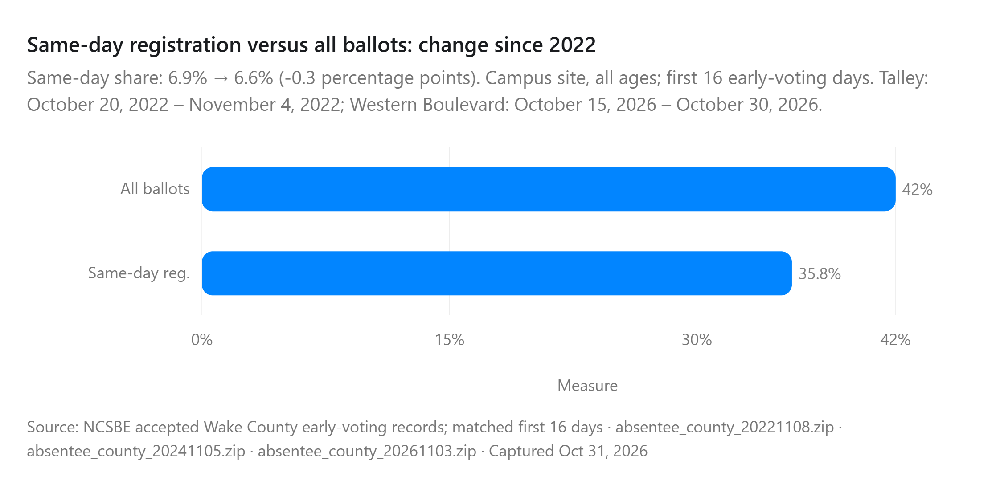

# NC State Campus Voting

Data and reporting workspace for a Technician follow-up on voting at NC State.

**[Open the interactive report](https://strokeofluck.github.io/ncsu-campus-voting/)** · [Findings and methods](docs/2026-early-voting-update.md) · [References](references.html)

## October 31, 2026 update: Talley to Western Boulevard

The latest downloaded NCSBE file covers voting through **October 30, 2026**. The report opens with **Talley Student Union in 2022 versus Western Boulevard Business Services in 2026**, using the same first **16 early-voting days**. **2022 and 2026 are midterms.** A selector retains 2024 as a presidential-election benchmark. Early voting and Election Day remain separate.

The primary midterm comparison shows **40.5% more ages 18–24 ballots at the campus site** and **103.6% more across Wake County** than in 2022. All-age Wake early voting grew **55.1%**.

### Same-day registration grew more slowly than total campus-site voting

Over the same first 16 days, campus-site same-day registrations rose from **646 to 877 (+35.8%)**, while all accepted ballots rose from **9,339 to 13,266 (+42.0%)**. Same-day registration's share of site ballots edged down from **6.9% to 6.6%**, a **0.3 percentage-point decline**. Both counts increased; the change in share is modest. This includes all ages and does not identify students or establish an effect of the location move.



[Exact same-day-registration comparison, both historical baselines and all scopes](data/processed/comparison/same_day_registration_comparison.csv) · [Verify the share change and its inputs](figure-source.html#sdr-share-change-2022-campus-site).

### Retained 2024 presidential-election benchmark

| Measure | Talley, 2024 | Western Boulevard, 2026 | Change |
| --- | ---: | ---: | ---: |
| Accepted early ballots, all ages | 20,350 | 13,266 | -34.8% |
| Accepted early ballots, ages 18–24 | 8,950 | 4,214 | -52.9% |
| Ages 18–24 share of site ballots | 44.0% | 31.8% | -12.2 percentage points |
| Site share of Wake’s 18–24 early ballots | 22.1% | 18.3% | -3.8 percentage points |
| Accepted early ballots, ages 18–22 | 7,410 | 3,340 | -54.9% |

College-age ballots at the campus site were **52.9% lower** than in the matched 2024 period, while Wake County’s college-age ballots were **43.2% lower**. The site’s college-age share fell **12.2 percentage points**. These descriptive comparisons cannot isolate the move from election-cycle or other changes. Ages 18–24 are an age proxy, not verified NC State students.

### Exact campus-site counts, all three years

| Site / year | All ages | Ages 18–24 | Ages 18–22 | 18–24 share | Same-day registration | Same-day share |
| --- | ---: | ---: | ---: | ---: | ---: | ---: |
| Talley Student Union · 2022 | 9,339 | 2,999 | 2,313 | 32.1% | 646 | 6.9% |
| Talley Student Union · 2024 | 20,350 | 8,950 | 7,410 | 44.0% | 2,084 | 10.2% |
| Western Boulevard · 2026 | 13,266 | 4,214 | 3,340 | 31.8% | 877 | 6.6% |

Dates: **October 20, 2022–November 4, 2022**; **October 17, 2024–November 1, 2024**; **October 15, 2026–October 30, 2026**. Each row covers 16 days. 2026 is preliminary; same-day registrations include all ages. Both shares use all site ballots as the denominator. Same-day-registration ballots are included in all ballots and must not be added to them.

**[Verify every highlighted figure against its source and arithmetic](https://strokeofluck.github.io/ncsu-campus-voting/verify-figures.html).** Campus totals and percentages are project calculations from NCSBE records. [Download the campus-site CSV](data/processed/comparison/campus_site_matched_counts.csv).


Underlined figures in the exact-count, age, voter-profile and benchmark tables open a dedicated evidence page showing the selected calculation, exact inputs, record filters, original CSV member and NCSBE download. The executive-summary figures are linked too. [Example: verify the 2024 ages 18–24 share](figure-source.html#demographic-2024-age-group-18-24). Choose **Preview the original file** to see the actual ZIP member list and CSV header, a filtered grouped extract retaining original field values, and an embedded live NCSBE file listing. Names, addresses and voter IDs are omitted. NCSBE does not print these calculated percentages on its download catalog; the official archive is the underlying record source.

The report compares ballot volume, age composition, individual ages 18 through 24, cumulative voting and the site's share of countywide college-age early votes. The individual-age chart switches between counts and share of all site ballots. The age-group table switches between 2026 versus 2024 and 2026 versus 2022, keeping rows in age order and showing the count and denominator behind each share. Party registration, gender, race and ethnicity remain separate selectable site-user breakdowns. [Download both age-group comparisons](data/processed/comparison/age_group_changes.csv).


### Retained 2022 midterm comparison

- Campus-site ballots, ages 18–24: **2,999 → 4,214 (+40.5%)**.
- Campus site share of Wake’s 18–24 early ballots: **26.6% → 18.3% (-8.2 percentage points)**.
- Ages 18–24 share of the site’s ballots: **32.1% → 31.8%**.

More college-age ballots were recorded at the replacement site, while countywide college-age early voting grew faster. The records cannot establish the move’s causal effect on student participation: enrollment and eligible-student denominators are unavailable, and mail/Election Day voting is outside this comparison.


### Rebuild the comparison

```bash
python scripts/download_early_voting_sources.py
python scripts/build_early_voting_comparison.py --cutoff-date 2026-10-30
python scripts/validate_early_voting_comparison.py
python scripts/audit_campus_figures.py
python scripts/build_reference_page.py
python scripts/build_figure_sources.py
python scripts/build_source_previews.py
python scripts/refresh_report_snapshot.py
```

Use a complete voting day covered by the downloaded file. The report is a dated snapshot and does not fetch live data. After refreshing the snapshot, rebuild the interactive app and update date-specific narrative and chart exports as described in [report-source/README.md](report-source/README.md). Raw voter-level data stay ignored; the locked full-period 2022 baseline remains unchanged.

Clickable figure references also embed an [actual original CSV viewer](csv-viewer.html?year=2024&figure=demographic-2024-age-group-18-24). On request, it reads the Wake County CSV directly from the live official NCSBE ZIP into the visitor's browser, checks its hash against the report snapshot, and offers original rows, all original columns, CSV text and pagination. Links open both the official file listing and the original ZIP URL. This supplemental live viewer does not change the report's saved figures; individual records are never added to this repository.

## Main research questions

- How many people used the NC State early-voting site in 2022 and 2026?
- Who used it by age, party registration, race, ethnicity and gender / sex field?
- How did the campus-area site compare with Wake County early voting overall?
- After the early-voting location changed, did site use, voter composition or voting method change?
- What happened in nearby Election Day precincts, without assuming precinct residents are NC State students?

## Project structure

- `references.html` — reporting source sheet with direct links and notes
- `methodology.md` — short methodology index
- `docs/early-voting-methodology.md` — early-voting source, filters and outputs
- `docs/election-day-methodology.md` — Election Day source, filters and outputs
- `docs/story-plan.md` — exact 2022-to-2026 reporting plan
- `scripts/build_2022_early_voting.py` — builds the Talley / Wake early-voting baseline
- `scripts/build_2022_election_day.py` — builds Wake Election Day precinct and polling-place baseline
- `data/processed/early_voting/` — publication-safe early-voting aggregates
- `data/processed/election_day/` — publication-safe Election Day aggregates
- `data/raw/` — ignored by Git; downloaded source files live here locally or temporarily in Actions

## 2022 early-voting source

North Carolina State Board of Elections, November 8, 2022 Absentee by County file:

https://s3.amazonaws.com/dl.ncsbe.gov/ENRS/2022_11_08/absentee_county_20221108.zip

The early-voting pipeline validates the Talley total against Wake County's published **10,390 ballots**.

## 2022 Election Day sources

NCSBE historical voter-history statistics:

https://s3.amazonaws.com/dl.ncsbe.gov/ENRS/2022_11_08/history_stats_20221108.zip

NCSBE polling places:

https://s3.amazonaws.com/dl.ncsbe.gov/ENRS/2022_11_08/polling_place_20221108.csv

## Reproducibility

Run the two baselines separately:

```bash
python scripts/build_2022_early_voting.py
python scripts/build_2022_election_day.py
```

GitHub Actions also rebuilds each side separately when its script or workflow changes. Raw voter-level data are not committed to this public repository.
